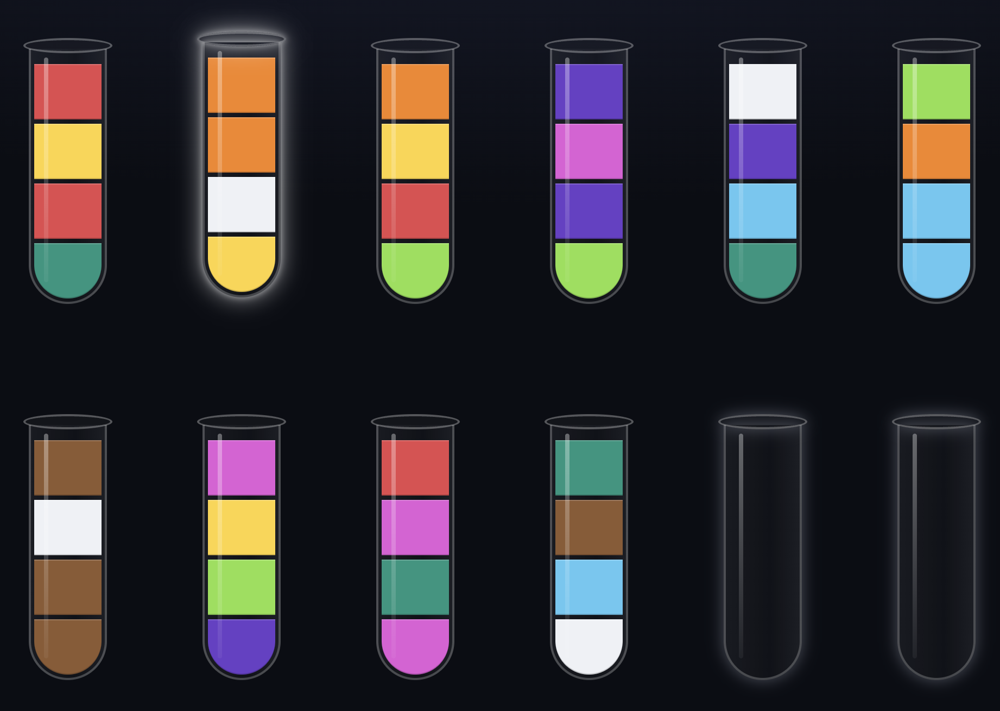

# Fluid Puzzle

### ▶ [Play Fluid Puzzle in your browser](https://wh1terabbithu.github.io/fluid-puzzle/)

#### Project Disclaimer

*AI generated project, code quality is not representative of my capabilities. Made it to have some fun with claude and to play this awesome game on the go, anywhere*

## Summary

Fluid Puzzle is a vial-sorting puzzle game that runs in your browser, on desktop and phone
alike. Nothing to install and no account needed: your game is saved in the browser, so you can
close the tab and continue later.

## How to play

### Goal

Sort the fluids so every vial holds a **single color**. You win when each vial is either
**empty** or **full with all 4 units of one color**.

The board has **12 vials**, each holding up to 4 units. There are **10 colors** with 4 units
each: a game starts with 10 full, mixed vials and 2 empty ones to give you room to maneuver.

### Pouring

1. Tap a vial to pick it up, then tap the vial to pour into.
2. Only the **top color** pours, all of its stacked units at once, as many as fit. Whatever
   doesn't fit stays behind.
3. It can land on the **same color** or in an **empty vial**.
4. A vial full of one color gets a **cap** and is locked: you can't pour from it anymore.

### Buttons

| Button          | What it does                                                                                       |
| --------------- | -------------------------------------------------------------------------------------------------- |
| **How to play** | Shows a short version of these rules. The clock pauses while it's open.                            |
| **Revert**      | Takes back the last pour, even if pouring it back wouldn't be legal. You can revert all the way to the start. |
| **Reset**       | Starts this board over from the beginning, with the clock and pours back at zero.                  |
| **New game**    | After confirming, deals a fresh board on the same difficulty. Use the menu to pick another one. The New game button after a game over or a solve does the same. |
| **Share**       | Shares a link to this board (or copies it), so a friend can play the exact same puzzle.            |

### Winning and losing

The puzzle is **solved** when every vial is empty or full of one color. If no pour is possible
anymore before that, the game is **over**: you can retry the same board or start a new one.

## Difficulty and seeds

A new game starts by picking a difficulty: **Easy**, **Medium** or **Hard**. The harder it is,
the more thoroughly the colors are mixed.

A board never starts with a capped vial. Every game has a **seed** code shown on the play
screen: click it to copy it, and use **Load seed** on the new-game page to play the same board
again, or to challenge a friend with it. Even easier: **Share** gives you a link that opens the
board straight away.

## Scoring

The clock starts with your first pour, and pauses while you're in the menu, reading How to
play, or away from the page. When you solve the puzzle, the success screen shows your score:

```
score = max(10, 1000 − 5 × ⌊seconds / 5⌋ − 10 × (pours − 1))
```

A solve is worth up to **1,000 points**. Every 5 seconds cost 5 points and every pour after the
first costs 10 (reverted pours count too). A solve always earns at least 10 points.

## Scores

Every solved game is saved in your browser. The **Scores** screen in the menu shows your overall
statistics (finished games, fastest solve, fewest pours and overall score, the sum of all your
scores) and lists your games, the most recent first, with when you finished, the difficulty, the
time, the pours and the seed. Scroll down and use **Load older games** to see 10 earlier ones at a
time, and click a seed to play that board again.

The complete rules, including how boards are generated, are in [RULES.md](RULES.md).

## Development

Building, testing and publishing the project is described in [SETUP.md](SETUP.md).
